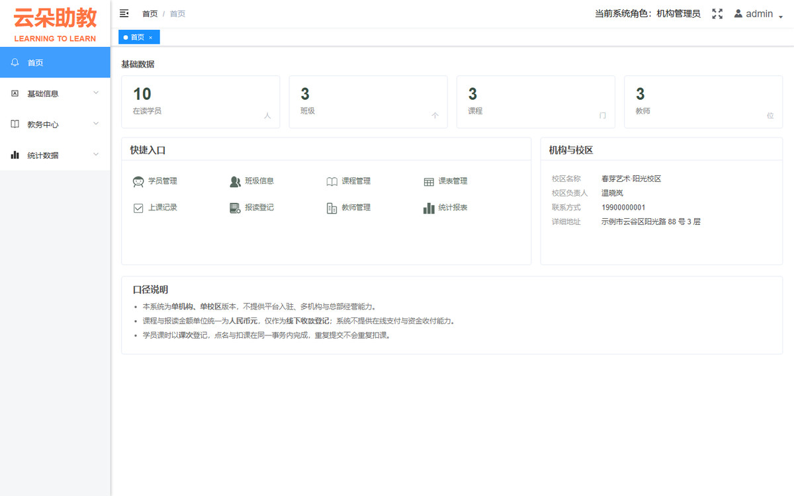
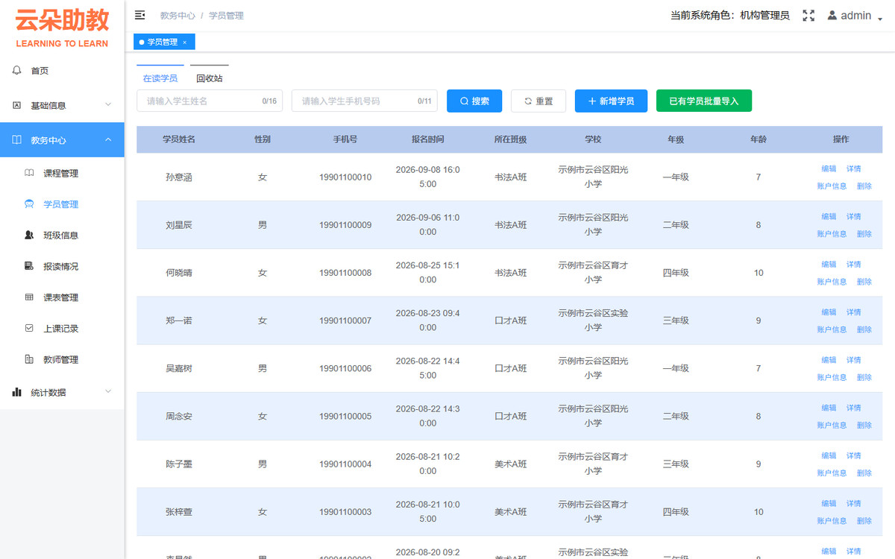
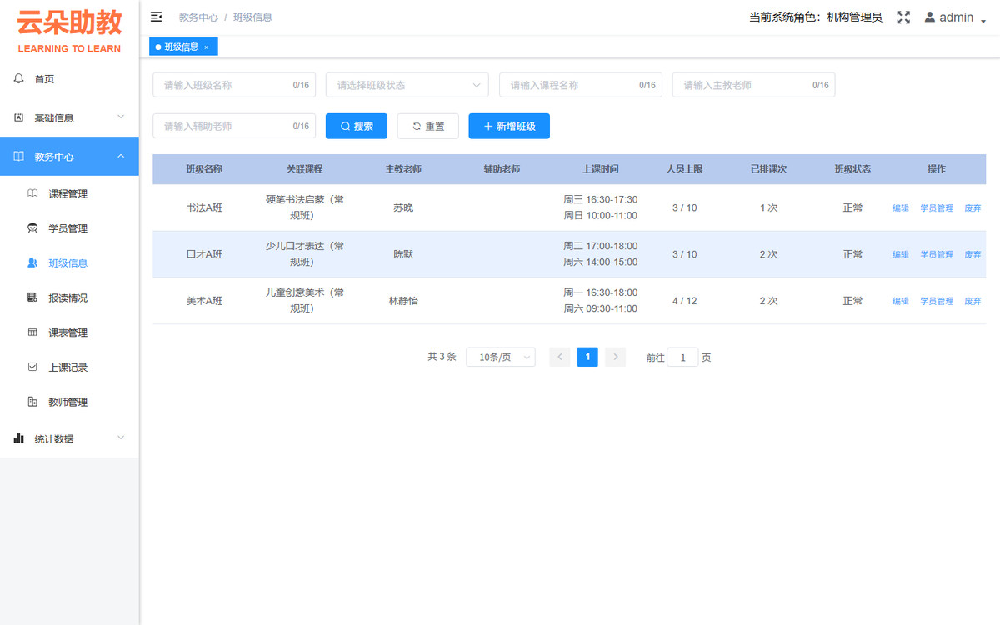
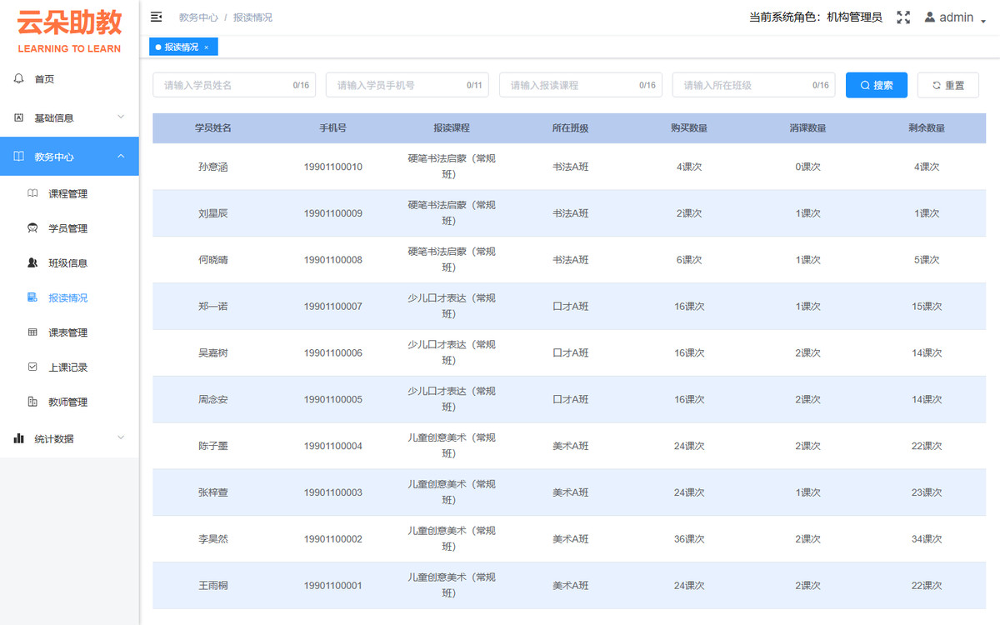
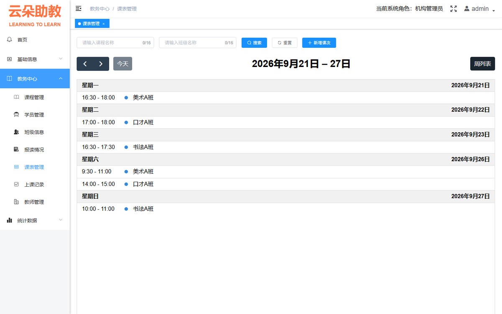
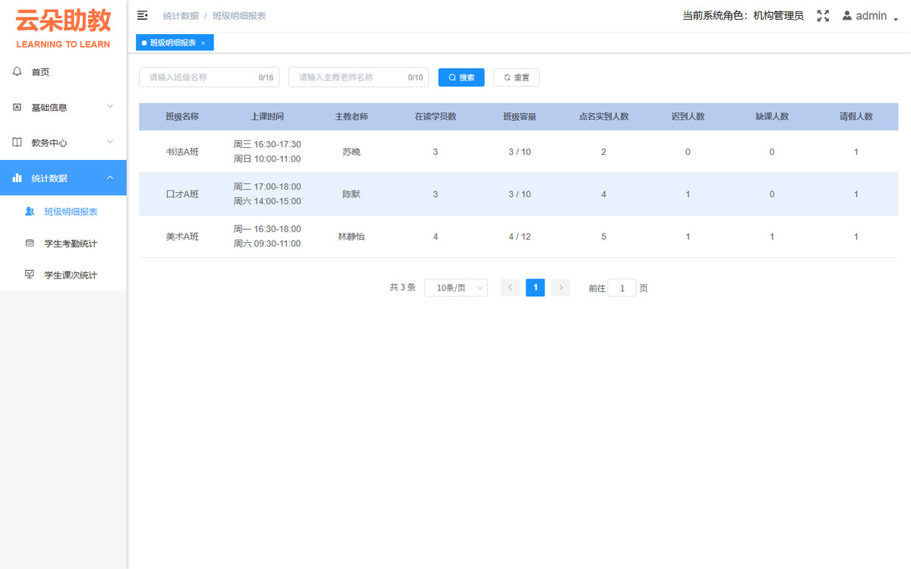
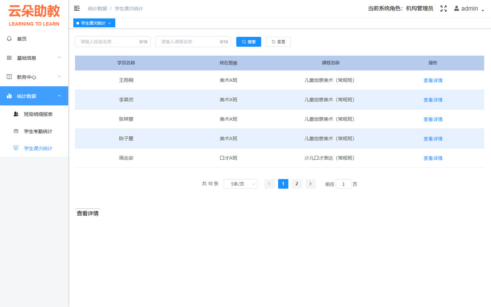
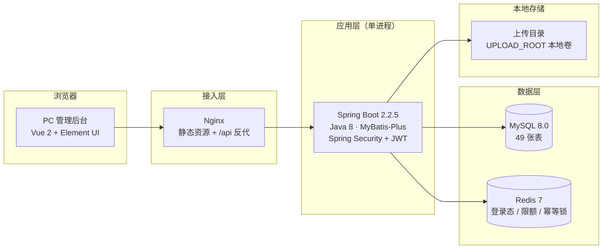

# 云朵教务 · 开源社区版（Yunduo Community Edition）

> **单机构单校区**的教培机构教务管理系统。学员报读 → 排课 → 点名扣课 → 课消流水 → 统计报表，
> 一条闭环全部开源、**不依赖任何第三方云服务**（无微信生态、无短信、无对象存储、无地图、无监控平台）。
>
> 许可证：**AGPL-3.0**（见 `LICENSE`）；需要闭源二次开发或 SaaS 化时见 [商业许可](#10-商业版入口)。

---

## 1. 这个版本适合谁

| 适合 | 不适合 |
|---|---|
| 一间机构、单一校区想自建教务系统（社区版按「单机构单校区」收口，初始化后不开放新建校区入口） | 需要「多机构入驻 + 平台抽成」的 SaaS 平台 |
| 想把点名扣课、课消流水、考勤统计落在自己服务器上 | 需要财务对账、招生营销、分销裂变、直播录播 |
| 想二次开发，且能接受 AGPL-3.0 的开源义务 | 需要闭源商用又不想买商业许可 |
| 想评估技术栈后再决定是否上商业版 | 直接要微信小程序家长端（社区版不提供） |

## 2. 功能范围

### 已有（社区版）

- **机构与校区**：机构信息、校区信息、机构人员、校区人员、角色与菜单权限（机构管理员 / 教务主管 / 授课教师三类内置角色）
- **教务中心**：课程管理、学员管理（含回收站与恢复）、班级信息、报读情况、课表管理、上课记录、教师管理
- **统计报表**：班级明细报表、学生考勤统计、学生课次统计
- **课时账**：线下报读登记增加课时、点名扣课、请假不扣课、重复点名拦截、课时不足拦截、纠错（改状态）自动退/扣课时，全流程留课时流水
- **基础信息**（机构管理员进入校区后可见）：校区人员、角色管理、菜单管理
- **本地化运行**：上传文件落本地目录；口令、令牌密钥一律从环境变量注入

> **关于 `sys_menu` 里那几组「看得见却进不去」的菜单**：种子数据保留了 RuoYi 原生的
> 「用户管理 / 字典管理 / 日志管理（含操作日志、登录日志）」，它们 `mec_type` 为空，
> 而菜单查询用的是 `mec_type = ?` 等值过滤 —— `NULL` 既不等于 0 也不等于 1，
> 因此**在社区版内置的三个角色下都不会出现在任何菜单里**；账号管理走「机构人员 / 校区人员」两个页面。
> 这件事是实测出来的（逐页截图 + role_menu 映射取证），不是推测，见 `docs/screenshots/README.md`。

### 明确排除（不在本仓库）

多机构平台管理 · 多校区管理与校区切换审批 · 财务与对账 · 招生线索与分销 · 直播/录播 ·
微信小程序家长端与公众号 · 短信验证码 · 第三方对象存储 · 地图服务 · 应用监控上报 ·
教师评价 · 续费提醒。上表未列的模块，一律视为**不在社区版范围内**。

### 界面一览（本仓库实测截图）

下面 8 张图是**从本仓库的构建产物跑出来的**，不是设计稿：空库建到 `003_demo_data.sql`、起真后端、
用 `admin-web/dist`（与 Docker 镜像里打包的是同一份产物）逐页截图，每张都断言过
「侧边栏出现该菜单标题 + 页面不是登录页/错误页 + 像素不是空白」。
生成方式与逐页断言见 **`docs/screenshots/README.md`**。

| | |
|---|---|
| <br>登录页（无自助注册入口） | <br>首页（进入校区后的工作台） |
| <br>学员管理（含剩余课时） | <br>班级信息 |
| <br>报读情况（课时账：购买 / 消课 / 剩余） | <br>课表管理（周视图排课） |
| <br>班级明细报表 | <br>学生课次统计 |

> 图里的机构「春芽艺术工作室」、学员姓名与手机号全部来自虚构演示数据（手机号为 `199` 开头的虚构连号，仅供本地演示；社区版不含短信/消息发送能力，不会向任何号码发送消息）。
> 图注只写**截图里真的能看到**的东西：例如「报读情况」这一页只显示课时三列（购买/消课/剩余），
> 该页**不显示金额**；金额（人民币元，`amount_cny`）在**学员账户信息**（报读登记）中录入并在**学员课时账户导出**中展示，
> 单位统一标注为「元·人民币」。同一页面不会出现「元」与虚拟点数混用。

## 3. 技术架构



- 后端 427 个 Java 文件、33 个 Controller；数据库 49 张表（其中 38 张业务/系统表 + 11 张保留的 Quartz 结构表）
- 前端 43 个页面、25 个 API 模块
- 没有消息队列、没有外部缓存集群、没有短信/推送网关；**一个 JVM + 一个 MySQL + 一个 Redis 就是全部**

## 4. 快速启动（10～15 分钟）

### 方式 A：Docker Compose（推荐）

```bash
git clone <这个仓库地址> && cd community-edition
cp deploy/.env.example deploy/.env
#   编辑 deploy/.env：至少改 MYSQL_ROOT_PASSWORD / MYSQL_PASSWORD / REDIS_PASSWORD /
#   TOKEN_SECRET / INITIAL_ADMIN_PASSWORD（每个都有生成命令写在旁边）

docker compose --env-file deploy/.env -f deploy/docker-compose.yml up -d --build
docker compose --env-file deploy/.env -f deploy/docker-compose.yml ps    # 四个服务都应是 healthy
```

打开 `http://<你的机器>:8080`，用 `admin` + 你设的 `INITIAL_ADMIN_PASSWORD` 登录，**首次登录会要求改密**。

> **关于「验过没验过」，这里先说清楚**：本仓库的 Compose 编排已经过**离线校验**（结构断言、Compose 官方规范
> schema 校验、配置完备性对表、凭据扫描、以及用同样的环境变量以 `docker` profile 起真进程跑通登录与上传），
> 但**尚未在真实 Docker 环境中跑过 `docker compose up` 端到端**。哪些验过、哪些没验，见 `deploy/README.md` 第 3 节
> 的对照表 —— 请以那张表为准，不要以本节命令为准。

想一并导入演示数据（虚构机构「春芽艺术工作室」）就在命令里再加一个 `-f deploy/docker-compose.demo.yml`。
细节与注意事项见 **`deploy/README.md`**（含「哪些检查已在无 Docker 环境验过、哪些还没验」）。

### 方式 B：本地直接跑

1. **准备数据**：建库（要求库名前缀 `yunduo_community`），依次执行
   `database/001_schema.sql` → `database/002_seed_system.sql`（→ 可选 `database/003_demo_data.sql`）
2. **准备 Redis**：建议用独立逻辑库（默认 12）
3. **配置环境变量**：复制 `scripts/env.local.example` 为 `env.local` 后 `set -a && source env.local && set +a`
4. **起后端**：`cd backend && mvn -o spring-boot:run`（JDK 8 + Maven）
5. **起前端**：`cd admin-web && npm ci && npm run dev`（依赖已由 `package-lock.json` 锁定；`legacy-peer-deps` 已由 `.npmrc` 固化；Node 22/24 需 `NODE_OPTIONS=--openssl-legacy-provider` 跑生产构建）

需要的最小环境变量只有 9 个：`MYSQL_HOST/PORT/DATABASE/USER/PASSWORD`、`REDIS_HOST/PORT/PASSWORD`、`TOKEN_SECRET`；
空库首次启动还要 `INITIAL_ADMIN_PASSWORD`。**少任何一个，后端都会明确拒绝启动**（不会偷偷用默认值）。

## 5. 演示数据

部署完的系统是空的。如果想先看到一间「正在上课」的机构，再开始录入自己的数据，
可以在初始化时多执行一个脚本 —— `database/003_demo_data.sql`。

它会为你准备一间虚构的「春芽艺术工作室 · 阳光校区」：三位老师带着三个班，
10 个孩子分别处在续费后课时充足、快要上完、经常请假等不同状态；一周的课表已经排好，
最近五次课的点名记录、报读登记和对应的课时流水也都齐了。也就是说，打开课表能点名，
打开统计能看到真实的出勤分布，打开学员账户能看到每一笔课时是怎么增减的——
正好把系统从头到尾走一遍，再决定怎么把自己的机构录进去。

这间机构完全是虚构的：姓名是编的，电话统一用 `199` 开头的占位号段，没有身份证号、
没有微信 OpenID，SQL 文件里也不含任何口令——口令由你自己在下面这一步设置，
脚本会把它们写进数据库，而不是留在任何文件里：

```bash
set -a && source scripts/env.local && set +a
export DEMO_PASSWORD='<你自己定的演示口令>'
python scripts/set-demo-passwords.py
```

生产环境不用导入这个文件——只执行 001 和 002 两个脚本，得到的就是一间空机构。

## 6. 备份、恢复与升级

- **备份**：MySQL 逻辑备份（`mysqldump`）即可覆盖全部业务数据；上传目录（`UPLOAD_ROOT`）单独归档；
  Redis 只存登录态与限额，**不需备份**（丢了只会让所有人重新登录）。
- **恢复**：先恢复库，再恢复上传目录；顺序不能反（否则期间的新上传会被覆盖）。
- **升级**：先备份 → 拉新代码 → `001/002` 是幂等脚本可安全重复执行 → 启动后端（首次启动会自动做必要初始化）→
  清浏览器缓存重登。
- **注意两种「升级后会重新登录」的情况**：① 换了 `TOKEN_SECRET`；② 从更早版本升级到本版
  （登录令牌的 Redis key 加了应用级前缀，旧令牌会失效）。
- 详细步骤见 **`docs/OPERATIONS.md`**；首次部署逐项核对 **`docs/USER-SETUP-CHECKLIST.md`**（含必须替换的默认值）；
- 部署指南（源码/Docker 两种方式、升级、常见问题）见 **`docs/DEPLOYMENT.md`**。

## 7. 安全与漏洞报告

- 口令：只接受环境变量注入；初始管理员口令有强度硬校验，不达标**拒绝启动**；演示数据不携带任何口令。
- 令牌：JWT + Redis 登录态，密钥强度硬校验（长度 ≥ 32、不同字符 ≥ 8、拒绝占位符）；登录失败次数超限临时锁定。
- 权限：接口级 `@PreAuthorize` 鉴权；权限拒绝的形态是 **HTTP 200 + `body.code=403`**（客户端判码，不判状态码）。
- 暴露面：默认关闭 Swagger 与 Druid 控制台；Docker 部署只发布前端端口，MySQL/Redis 不对外。
- **发现安全问题请勿直接开公开 Issue**，按 `SECURITY.md` 的方式私下上报。

## 8. 测试与验收

- 后端集成测试：`cd backend && mvn -o test -Pcommunity-verify`（12 项最低测试集 = 15 个用例，含负向对照）。
  注意：pom 里有 `skipTests=true` 用于打包提速，**必须带 `-Pcommunity-verify`** 才会真的跑；
  `Tests run: 0` 就是漏带了 profile。
- 首次在全新机器上跑测试需要联网（Maven 要下载 surefire provider），之后就支持离线。
- 端到端验收入口（需自行准备环境变量）：`scripts/smoke-test.py`、`scripts/verify-env.py`。
- 界面截图不是手工截的：用 headless Chrome 逐页打开、逐页断言生成，复跑得到同样的图；
  说明与每页的断言写在 `docs/screenshots/README.md`。

## 9. 社区版与商业版对比

| 能力 | 社区版（本仓库，AGPL-3.0） | 商业版 |
|---|---|---|
| 单机构 + 单校区/多校区**数据模型** | ✅（按单机构单校区收敛） | ✅ |
| 多机构平台管理、机构入驻审批 | ❌ | ✅ |
| 学员 / 课程 / 班级 / 课表 / 点名 / 课消 / 统计 | ✅ | ✅ |
| 财务对账、收款渠道对接 | ❌（只有线下收款登记 `amount_cny`） | ✅ |
| 招生营销（线索、分销、活动） | ❌ | ✅ |
| 微信公众号 / 小程序家长端 | ❌ | ✅ |
| 短信验证码、模板消息 | ❌ | ✅ |
| 第三方对象存储、直播/录播 | ❌ | ✅ |
| 商业保证、SLA、实施与培训 | ❌（社区支持，尽力而为） | ✅ |
| 闭源二次开发 | 需满足 AGPL-3.0 或购买商业许可 | ✅ |

> 金额口径：社区版**只使用 `amount_cny`（人民币元 · 线下收款登记）**，不存在任何虚拟点/云朵点与人民币的换算链路。

## 10. 商业版

社区版与商业版**共用同一套教务内核与数据库结构**，从社区版升级到商业版不需要重建数据、不需要迁移业务，
按 `docs/OPERATIONS.md` 完成备份后平滑升级。双许可与适用范围见 **`COMMERCIAL-LICENSING.md`**。

### 10.1 商业版在社区版之上多什么

社区版是「**单机构教务最小闭环**」；商业版是在它之上长出来的「**多机构平台化运营**」完整 SaaS——
你今天在社区版里录入的教师、课程、班级、学员、课消与流水，升级后全部沿用。

**平台端（总部运营）**
- 机构入驻与审核、机构信息与品牌定制、微官网/资讯/市场活动审核
- 平台财务：机构流水、家长流水、财务对账
- 客服管理、平台人员与角色、Banner 与资讯配置

**机构端（在社区版能力之上追加）**
- 多校区总部管理与校区维护升级
- **销售中心**：线索收集、公海池、线索分配、跟进记录与转化分析
- **营销增长**：分销活动、拼团活动、市场活动与效果分析
- **在线课程**：直播课程（播放/回放/互动/分享/分析）、录播课程（购买/分销/分析）
- **运营触达**：续费预警批量发送、考勤通知、上课提醒（短信/微信模板消息）
- **微官网**：校区主页定制、信息收集与展示、校区资讯

**家长端微信小程序**
- 微信登录认证、OpenID 绑定、验证码
- 附近机构 / 附近课程 / 附近活动发现；机构内容推荐
- 在线购课与**微信支付**、云朵点充值、我的课程与在线续费
- 拼团、分销中心（分销订单与提现）
- 课表、作业、成长日志、请假、课次查询、意见反馈
- 家校通：与老师聊天、通讯录、消息通知

**机构端小程序**
- 移动工作台、课表与点名、学员与班级管理、家校通消息

### 10.2 产品截图（更多见 cloud-TA 仓库 `doc/` 目录，共 27 张）

| | |
|---|---|
|  |  |
|  |  |

### 10.3 咨询与升级

- **商务咨询**：duanmingwei@szzhenshu.com ｜ **官网**：www.szzhenshu.com ｜ **个人微信**：iamdmw
- 双许可与商业许可的适用范围：**`COMMERCIAL-LICENSING.md`**；第三方组件许可清单：**`THIRD_PARTY_NOTICES.md`**
- 技术问题请走仓库 Issue（社区支持，尽力而为）；安全披露见 `SECURITY.md`

<p align="center">
  <br>
  <sub>微信扫码联系（微信号 iamdmw）</sub>
</p>

## 11. 贡献与支持边界

欢迎提 Issue 与 PR，约定见 **`CONTRIBUTING.md`**。请先明确支持边界：

- **社区版只接受**：缺陷修复、文档改进、社区版范围内的功能增强、测试补充。
- **社区版不接受**：把商业版模块（多机构平台、财务、营销、微信生态等）合并进本仓库的 PR。
- **不承诺**：响应时间、版本节奏、向后兼容性（商业版才有 SLA）。
- 提交前请确认你已阅读 `SECURITY.md`（漏洞）与 `LICENSE`（许可义务）。

## 12. 目录结构

```
community-edition/
├── LICENSE                      AGPL-3.0 全文
├── COMMERCIAL-LICENSING.md      双许可与商业许可说明
├── THIRD_PARTY_NOTICES.md       第三方组件许可清单
├── SECURITY.md                  漏洞报告方式
├── CONTRIBUTING.md              贡献与支持边界
├── database/                    001 结构 / 002 系统种子 / 003 演示数据（均可重复执行）
├── backend/                     Spring Boot 后端（Java 8）
│   └── src/test/java/com/zhenshu/community/   集成测试（OS012 起）
├── admin-web/                   PC 管理后台（Vue 2 + Element UI）
├── deploy/                      Docker Compose 部署（compose / Dockerfile / nginx / .env.example）
├── scripts/                     环境校验、冒烟测试、演示口令注入、默认头像生成
├── docs/                        运维手册 + 实测界面截图
│   └── screenshots/             README 用的 8 张界面截图（含生成说明）
└── MANIFEST.sha256.*            候选包逐文件校验清单（发布审计用）
```
